# Ajolotito Hambriento

Práctica 14: ejercicio guiado de TDD (desarrollo guiado por pruebas) con Flutter, sobre notificaciones locales.

- Alumno: Oscar Manuel Ayala Ortiz
- N.C. 1225100784, grupo GTID244
- Materia: Desarrollo de Aplicaciones Móviles
- Docente: Anastacio Rodríguez García

## Qué es

Una mascota virtual: un ajolote (Xólotl) al que le da hambre con el tiempo. Cuando tiene hambre, la app avisa con una notificación, aunque esté cerrada. El ajolote es el pretexto; lo que se practica es hacer bien las notificaciones: pedir el permiso en el momento correcto, canales de Android, horas de silencio, tope diario, no repetir avisos y qué pasa al tocar la notificación.

El ajolote no guarda "cuánta hambre tiene ahora". Guarda cuánta saciedad tenía y desde cuándo, y la saciedad de cualquier momento se calcula: `base - horas × 10`. Así se puede predecir a qué hora tendrá hambre (saciedad 40, a las 6 horas) y a qué hora estará famélico (15, a las 8.5 horas), y la notificación se programa desde antes.

## Notificaciones

- Se usa `flutter_local_notifications` (versión 20, con parámetros con nombre).
- Hay dos canales de Android: **Hambre del ajolote** (importancia alta) y **Sorpresas y juegos** (importancia baja, una al día a las 6 pm). Cada uno se puede apagar por separado.
- El permiso **no** se pide al abrir la app. Primero sale una explicación propia con "Ahora no" y "Sí, avísame"; el diálogo del sistema solo sale si el usuario dice que sí. Si lo rechaza, no se vuelve a preguntar: se le ofrece ir a Ajustes.
- Nada entre 10 pm y 8 am. Si un aviso cae ahí, se mueve a las 8:00.
- Cada aviso tiene un id fijo (hambre 1, crítico 2, sorpresas 100 a 102). Programar con el mismo id reemplaza el anterior, así nunca llegan duplicados.
- Mientras la app está en pantalla no se programan avisos de hambre, porque ya se ve la barra. Al salir de la app se programan.
- La notificación de hambre trae un botón **"Dar de comer 🍤"** que alimenta al ajolote de una vez.
- **Modo clase:** 1 hora del ajolote pasa en 1 minuto, para ver los avisos a los 6 y 8.5 minutos.

## Cómo se hizo

Seguí el manual paso a paso. En cada ronda hice lo mismo:

1. **Rojo:** escribo la prueba y la corro. Falla porque todavía no existe el código.
2. **Verde:** escribo el código que hace pasar la prueba.
3. **Refactor:** si se puede mejorar, lo arreglo y vuelvo a correr las pruebas.

La lógica está en `lib/dominio`. Es Dart puro, sin widgets ni plugins, y se prueba sin teléfono. El plugin de notificaciones solo se usa en `lib/infra/puerto_real.dart`; en las pruebas se usa un `PuertoFalso` (`test/falsos.dart`) que cumple la misma interfaz.

## Las 13 rondas

| Ronda | Qué se hizo | Archivo |
|-------|-------------|---------|
| 0 | Los diez mandamientos de una notificación (reglas, sin código) | — |
| 1 | Preparar el proyecto: dependencias, permisos y receptores de Android | `pubspec.yaml`, `AndroidManifest.xml` |
| 2 | El reloj como dependencia y el ajolote: saciedad, humor, predicción, alimentar y guardar en JSON | `reloj.dart`, `mascota.dart` |
| 3 | Categorías, canales y mensajes con personalidad | `categoria.dart`, `mensajes.dart` |
| 4 | Política de buena educación: horas de silencio que cruzan la medianoche | `politica.dart` |
| 5 | El payload: lo que viaja dentro de la notificación, con versión y sin tronar | `payload.dart` |
| 6 | El planificador: del estado del ajolote a la lista de avisos | `planificador.dart` |
| 7 | El puerto: interfaz que aísla el plugin para poder probar | `puerto.dart`, `test/falsos.dart` |
| 8 | El permiso: pedirlo una sola vez y, si dice que no, mandar a Ajustes | `gestor_permiso.dart`, `almacen.dart` |
| 9 | El servicio: sincronizar lo programado cada vez que algo cambia | `servicio.dart` |
| 10 | El adaptador real del plugin y el almacén con SharedPreferences | `puerto_real.dart`, `almacen_prefs.dart` |
| 11 | ViewModel, pantallas y arranque | `ajolote_vm.dart`, `pantalla_ajolote.dart`, `pantalla_ajustes.dart`, `main.dart` |
| 12 | Probar en un teléfono de verdad (Galaxy S22+, Android 16) | — |
| 13 | Notificaciones push (solo lectura, no se programa) | — |

Cambio que tuve que hacer: el manual pide `app_settings: ^5.1.1`, pero esa versión compila con Android SDK 33 y sus dependencias de AndroidX piden 34 o más, así que el APK no compilaba. La subí a `app_settings: ^9.0.1`; el código quedó igual.

## Rojo y verde por módulo

Cada ronda corre el archivo de pruebas de un módulo, primero en **rojo** (falla) y luego en **verde** (pasa). El código ya estaba terminado, así que el rojo se provocó cambiando temporalmente una línea, indicada en cada ronda. Después se regresó la línea original y se volvió a correr el archivo.

### Ronda 1 – Mascota

**Archivo de pruebas:** `mascota_test.dart`

**Cambio para provocar el fallo:** `mascota.dart`: la porción de comida se cambió de `35` a `30`.

**ROJO** – La prueba falla

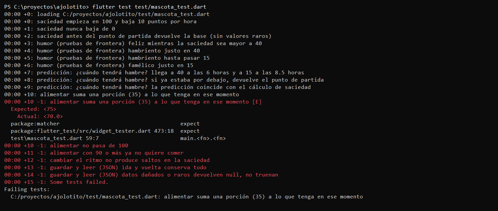

**VERDE** – Se revierte el cambio y las pruebas pasan

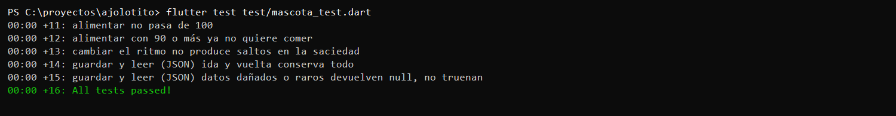

### Ronda 2 – Política y payload

**Archivo de pruebas:** `politica_payload_test.dart`

**Cambio para provocar el fallo:** `politica.dart`: en el silencio que cruza la medianoche se cambió `||` por `&&` (`hora >= 22 && hora < 8` nunca se cumple).

**ROJO** – La prueba falla

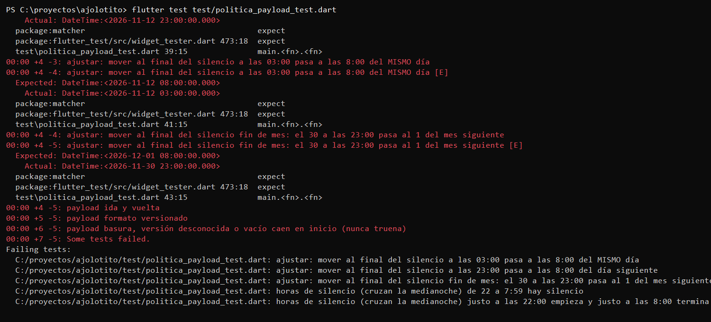

**VERDE** – Se revierte el cambio y las pruebas pasan

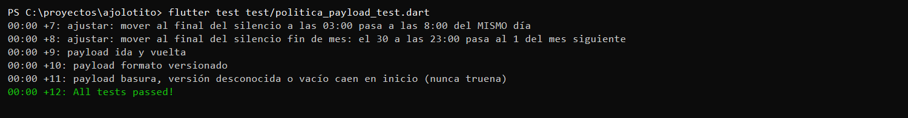

### Ronda 3 – Planificador

**Archivo de pruebas:** `planificador_test.dart`

**Cambio para provocar el fallo:** `planificador.dart`: la hora de la sorpresa se cambió de `18` a `19`.

**ROJO** – La prueba falla

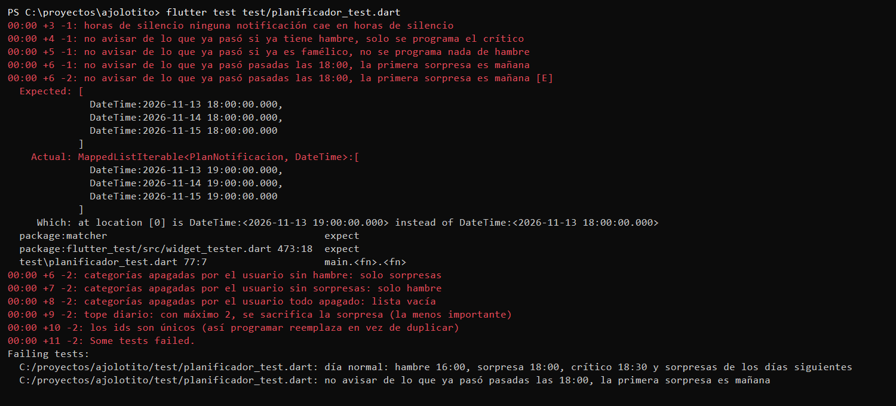

**VERDE** – Se revierte el cambio y las pruebas pasan

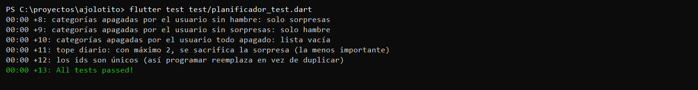

### Ronda 4 – Permiso

**Archivo de pruebas:** `permiso_test.dart`

**Cambio para provocar el fallo:** `gestor_permiso.dart`: se comentó la línea que guarda que ya se preguntó el permiso, así que la app volvía a preguntar.

**ROJO** – La prueba falla

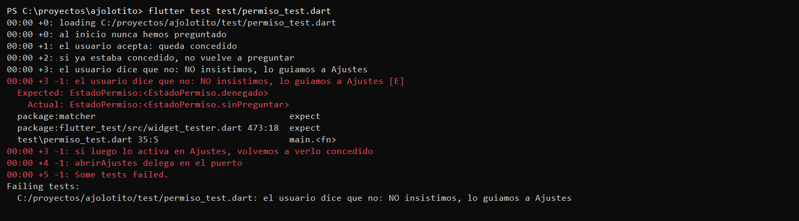

**VERDE** – Se revierte el cambio y las pruebas pasan

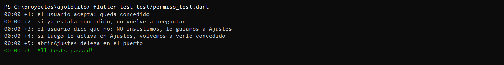

### Ronda 5 – Servicio

**Archivo de pruebas:** `servicio_test.dart`

**Cambio para provocar el fallo:** `servicio.dart`: se quitó el filtro de primer plano, así que se programaban avisos de hambre con la app abierta.

**ROJO** – La prueba falla

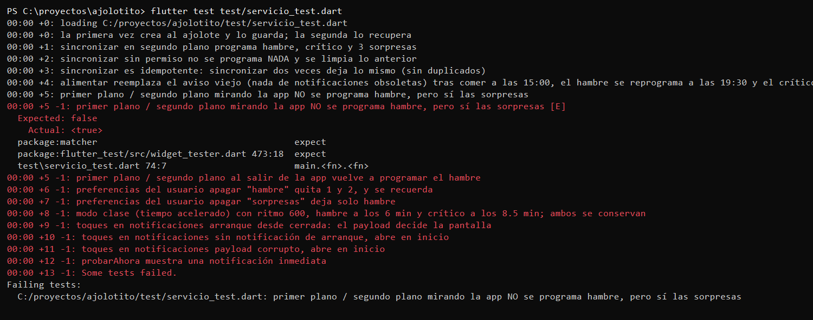

**VERDE** – Se revierte el cambio y las pruebas pasan

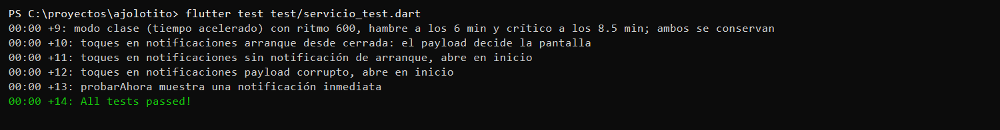

### Ronda 6 – ViewModel

**Archivo de pruebas:** `vm_test.dart`

**Cambio para provocar el fallo:** `ajolote_vm.dart`: `alimentar` llamaba a `servicio.cargar()` en lugar de `servicio.alimentar()`, así que el ajolote no comía.

**ROJO** – La prueba falla

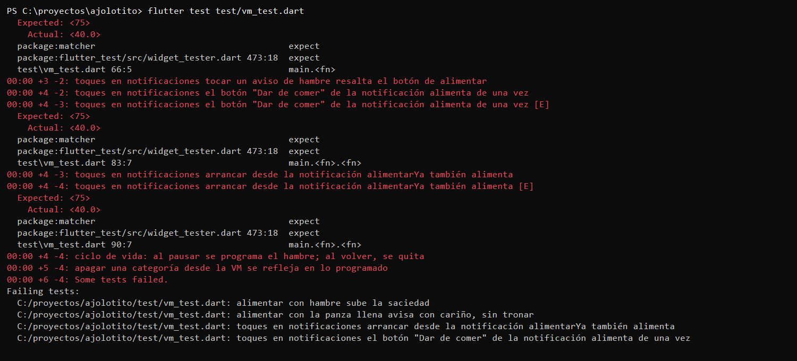

**VERDE** – Se revierte el cambio y las pruebas pasan

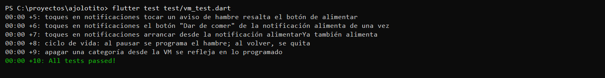

### Ronda 7 – Pantalla

**Archivo de pruebas:** `pantalla_test.dart`

**Cambio para provocar el fallo:** `pantalla_ajolote.dart`: se comentó el `return` de "Ahora no", así que el permiso del sistema se pedía aunque el usuario dijera que no.

**ROJO** – La prueba falla

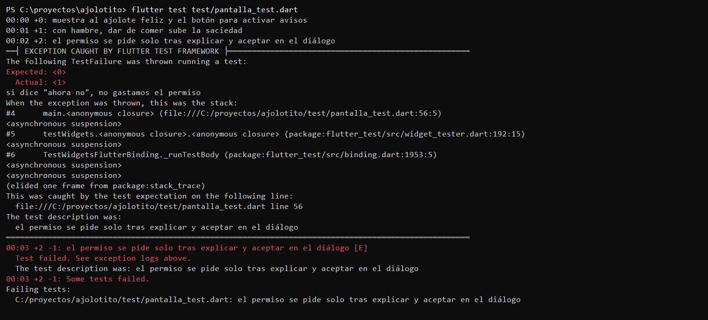

**VERDE** – Se revierte el cambio y las pruebas pasan

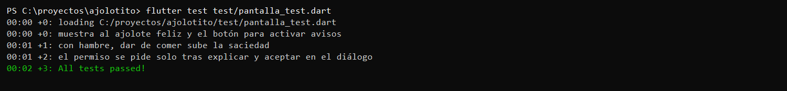

Al final, `flutter test` pasa las 74 pruebas (captura en la sección de evidencia).

## Carpetas

```
lib/
  dominio/reloj.dart
  dominio/mascota.dart
  dominio/categoria.dart
  dominio/mensajes.dart
  dominio/politica.dart
  dominio/payload.dart
  dominio/planificador.dart
  dominio/puerto.dart
  dominio/almacen.dart
  dominio/gestor_permiso.dart
  dominio/servicio.dart
  infra/puerto_real.dart
  infra/almacen_prefs.dart
  presentacion/ajolote_vm.dart
  presentacion/dibujo_ajolote.dart
  presentacion/pantalla_ajolote.dart
  presentacion/pantalla_ajustes.dart
  app.dart
  main.dart
test/
  falsos.dart
  mascota_test.dart
  politica_payload_test.dart
  planificador_test.dart
  permiso_test.dart
  servicio_test.dart
  vm_test.dart
  pantalla_test.dart
```

## Cómo correrlo

```
flutter pub get
flutter test
flutter run
```

En la app se toca "Avísame cuando tenga hambre", se activa el modo clase y se sale de la app para recibir los avisos.

## Evidencia

Resultado de `flutter test` (son 74 pruebas en total: 16 de la mascota, 12 de política y payload, 13 del planificador, 6 del permiso, 14 del servicio, 10 del ViewModel y 3 de la pantalla):

```
PS C:\proyectos\ajolotito> flutter test
00:05 +74: All tests passed!
```

Captura de la terminal:

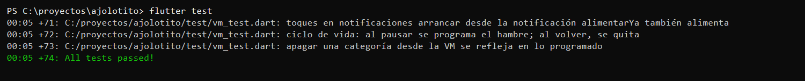

## Evidencia de la app funcionando

Se probó en un Samsung Galaxy S22+ con Android 16, siguiendo el recorrido de la ronda 12 con el modo clase.

| Primera vez: no pide permiso | Explicación propia antes del permiso | "Ahora no": no sale el diálogo del sistema |
|---|---|---|
| 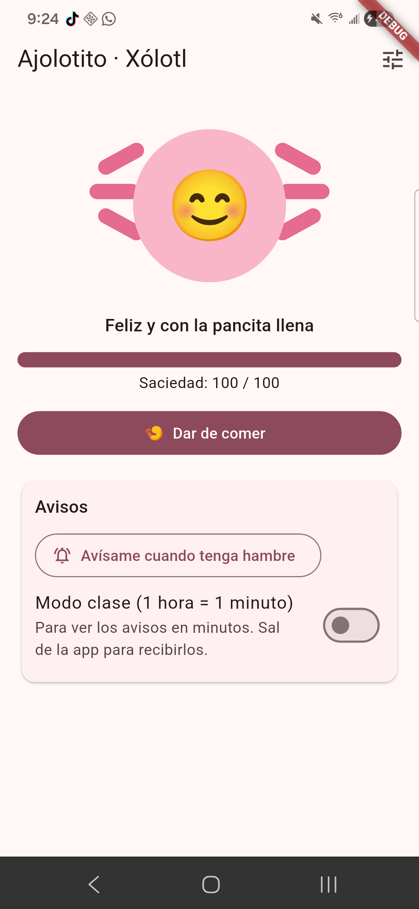 | 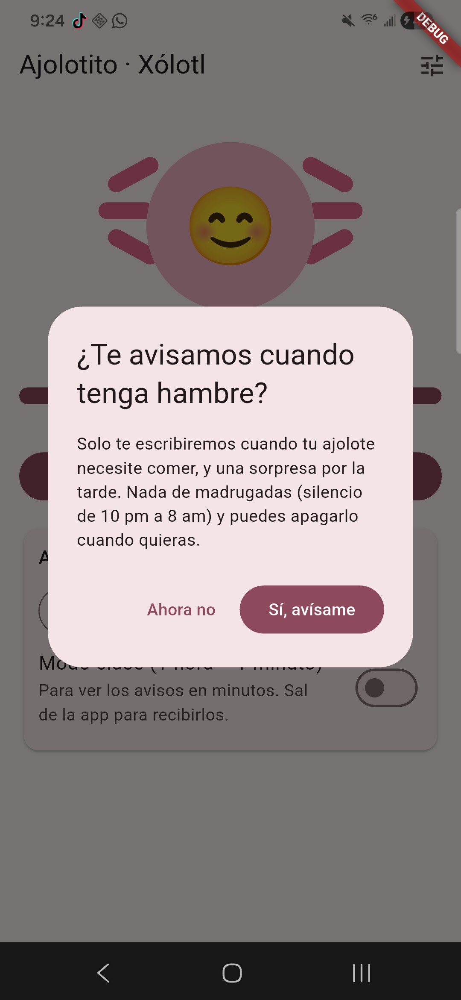 | 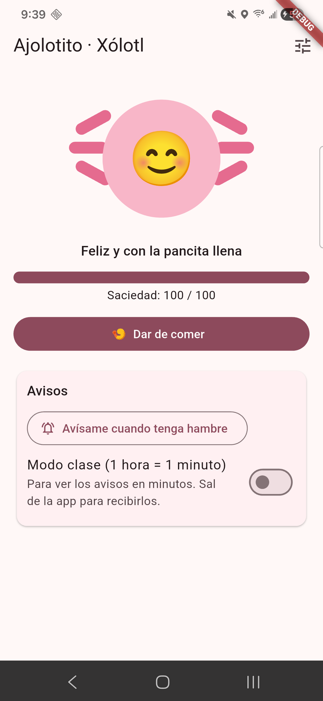 |

| Con "Sí, avísame" sale el del sistema | Avisos activados (con la app abierta solo hay sorpresas) | Modo clase activado |
|---|---|---|
| 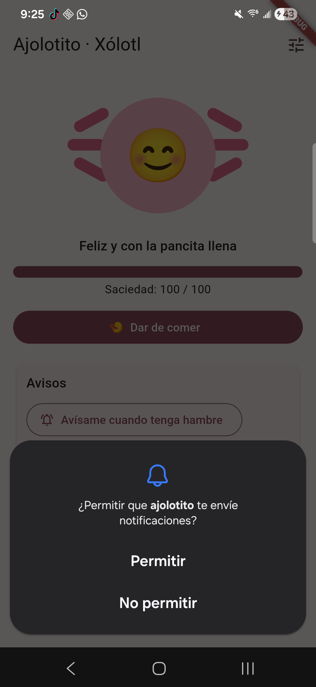 | 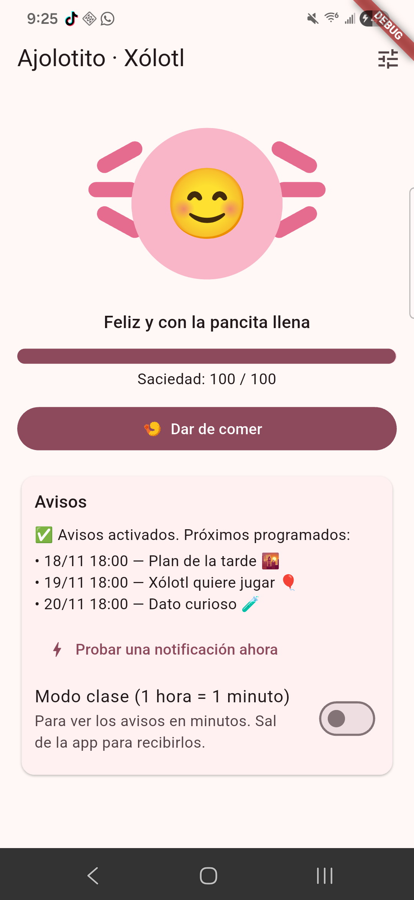 | 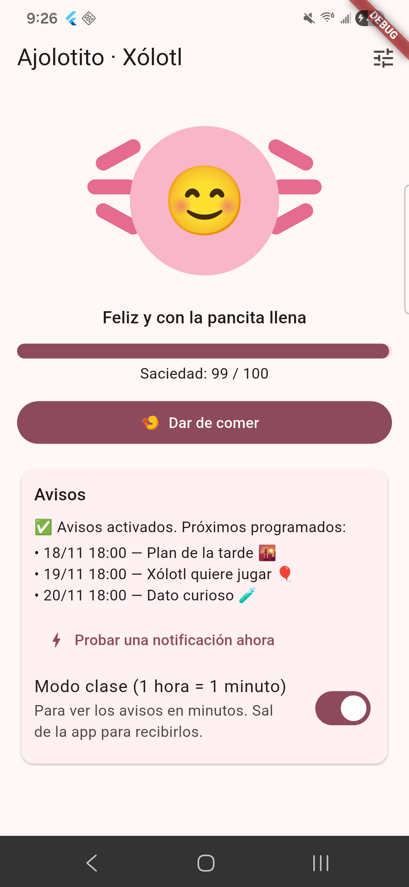 |

| Después de tocar "Dar de comer" en la notificación | Ajustes: cada tipo de aviso se apaga por separado |
|---|---|
| 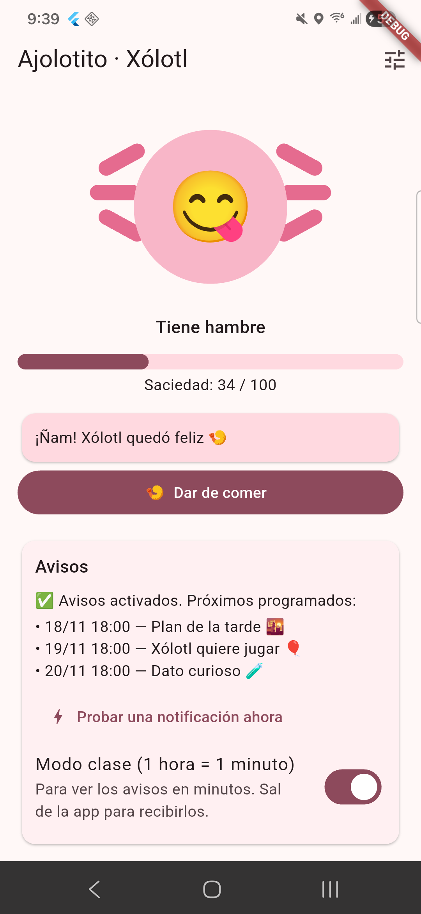 | 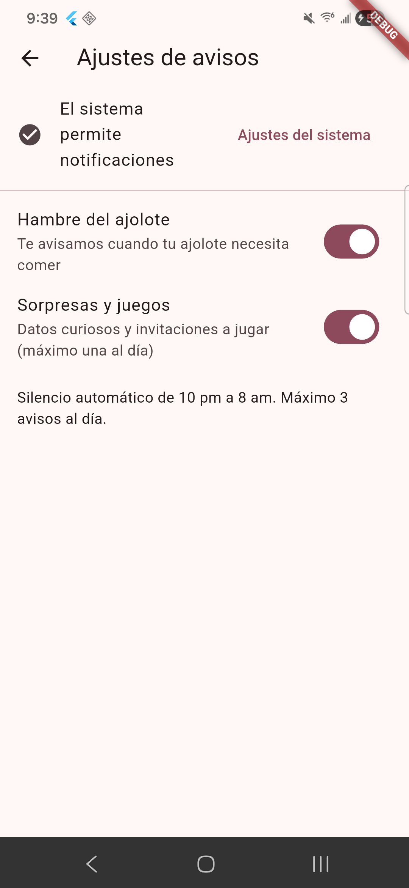 |

Notificación de prueba, que llega al instante:


Con el modo clase activado se salió de la app. Llegaron el aviso de hambre ("¡Hora de la comida!") y el crítico ("SOS desde el acuario"):

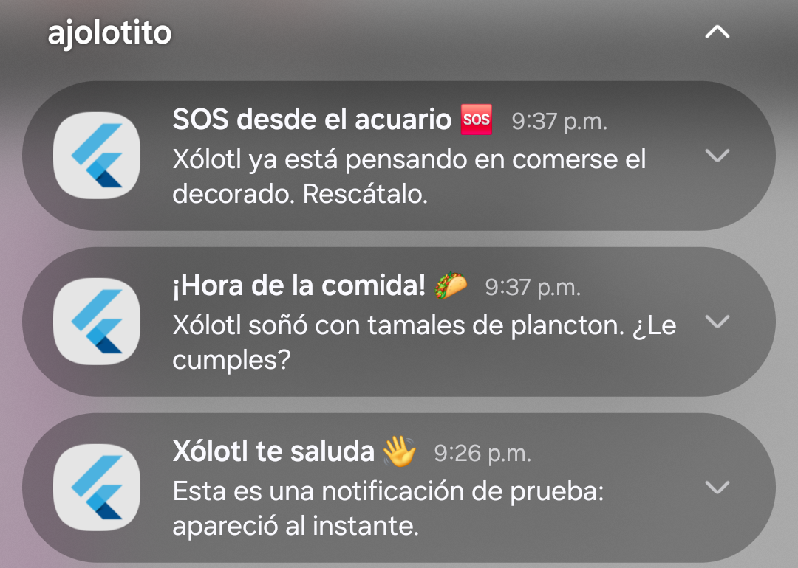

El aviso crítico trae el botón "Dar de comer 🍤". Al tocarlo se abre la app y el ajolote come de una vez (la saciedad pasó de 0 a 35):


Los avisos llegaron unos minutos tarde (programados a las 9:32 y 9:35, llegaron a las 9:37). Es normal: se usan alarmas inexactas (`inexactAllowWhileIdle`), que Android puede retrasar para ahorrar batería y que no necesitan el permiso especial de alarmas exactas de Android 12+.
